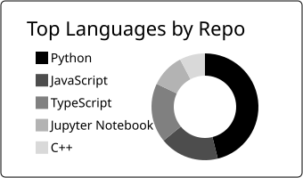
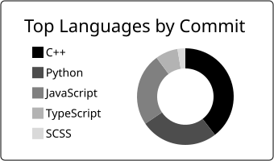
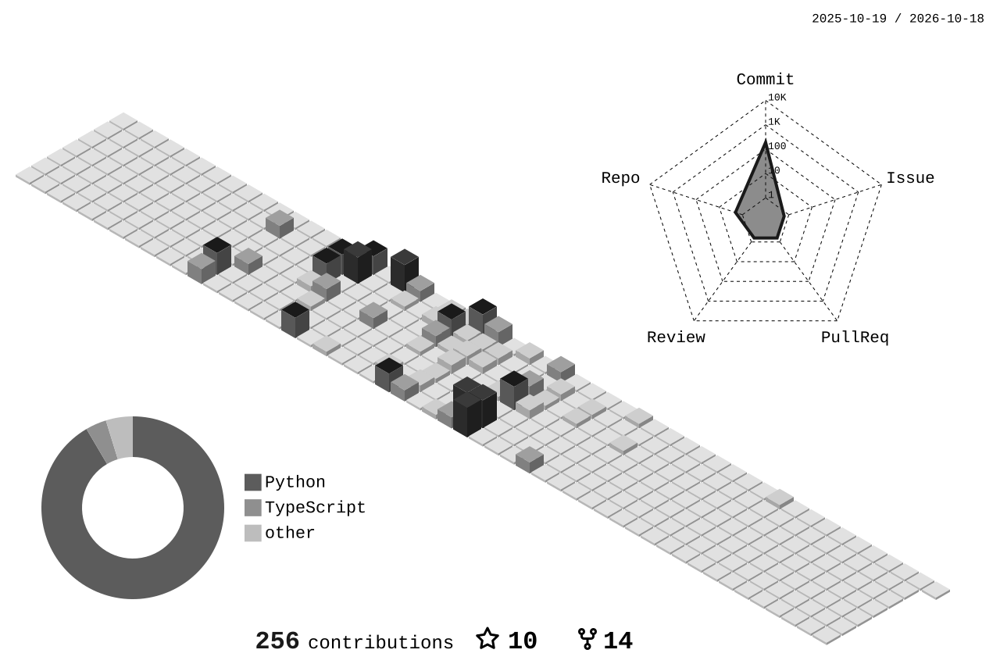

<!--

  GENERATED FILE — do not edit by hand.

  Content: theme/profile.json · Design tokens: theme/tokens.json

  Rebuild: node theme/build.js   (add --offline to skip network fetches)

-->

<picture><source media="(prefers-color-scheme: dark)" srcset="theme/assets/dark/header.svg"/></picture>

<a href="https://colddsam.dev"><picture><source media="(prefers-color-scheme: dark)" srcset="theme/assets/dark/badge-portfolio.svg"/></picture></a> <a href="https://drive.google.com/file/d/1PdT7z_OTmuz3gs02nRsrAx9_efc6rstA/view?usp=sharing"><picture><source media="(prefers-color-scheme: dark)" srcset="theme/assets/dark/badge-resume.svg"/></picture></a> <a href="https://www.linkedin.com/in/colddsam/"><picture><source media="(prefers-color-scheme: dark)" srcset="theme/assets/dark/badge-linkedin.svg"/></picture></a> <a href="https://www.instagram.com/colddsam/"><picture><source media="(prefers-color-scheme: dark)" srcset="theme/assets/dark/badge-instagram.svg"/></picture></a> <a href="https://github.com/colddsam"><picture><source media="(prefers-color-scheme: dark)" srcset="theme/assets/dark/badge-github.svg"/></picture></a> <a href="https://twitter.com/colddsam"><picture><source media="(prefers-color-scheme: dark)" srcset="theme/assets/dark/badge-x.svg"/></picture></a> <a href="mailto:colddsam@gmail.com"><picture><source media="(prefers-color-scheme: dark)" srcset="theme/assets/dark/badge-email.svg"/></picture></a> <a href="https://colddsam.medium.com"><picture><source media="(prefers-color-scheme: dark)" srcset="theme/assets/dark/badge-medium.svg"/></picture></a> <a href="https://linktr.ee/colddsam?utm_source=linktree_profile_share&amp;ltsid=2cda3886-be78-4ccf-a16a-3ef6943e4525"><picture><source media="(prefers-color-scheme: dark)" srcset="theme/assets/dark/badge-linktree.svg"/></picture></a>

<a href="https://git.io/typing-svg"><picture><source media="(prefers-color-scheme: dark)" srcset="https://readme-typing-svg.demolab.com?font=JetBrains+Mono&amp;weight=700&amp;size=26&amp;pause=1000&amp;color=FFFFFF&amp;center=true&amp;vCenter=true&amp;width=600&amp;lines=Hi+Developers%3BI+am+Samrat+Kumar+Das"/></picture></a>

<picture><source media="(prefers-color-scheme: dark)" srcset="theme/assets/dark/ticker.svg"/></picture>

<picture><source media="(prefers-color-scheme: dark)" srcset="theme/assets/dark/s01.svg"/></picture>

<picture><source media="(prefers-color-scheme: dark)" srcset="theme/assets/dark/whoami.svg"/></picture>

<picture><source media="(prefers-color-scheme: dark)" srcset="theme/assets/dark/s02.svg"/></picture>

<picture><source media="(prefers-color-scheme: dark)" srcset="theme/assets/dark/at-a-glance.svg"/></picture>

<picture><source media="(prefers-color-scheme: dark)" srcset="theme/assets/dark/s03.svg"/></picture>

<picture><source media="(prefers-color-scheme: dark)" srcset="theme/assets/dark/currently.svg"/></picture>

<picture><source media="(prefers-color-scheme: dark)" srcset="theme/assets/dark/s04.svg"/></picture>

<picture><source media="(prefers-color-scheme: dark)" srcset="theme/assets/dark/selected-work.svg"/></picture>

<a href="https://github.com/colddsam/coldscout"><picture><source media="(prefers-color-scheme: dark)" srcset="theme/assets/dark/badge-cold-scout-ext.svg"/></picture></a> <a href="https://coldscout.colddsam.com"><picture><source media="(prefers-color-scheme: dark)" srcset="theme/assets/dark/badge-cold-scout-live-ext.svg"/></picture></a> <a href="https://github.com/colddsam/Truth-Guardian"><picture><source media="(prefers-color-scheme: dark)" srcset="theme/assets/dark/badge-truth-guardian-ext.svg"/></picture></a> <a href="https://truthguardian.vercel.app"><picture><source media="(prefers-color-scheme: dark)" srcset="theme/assets/dark/badge-truth-guardian-live-ext.svg"/></picture></a> <a href="https://github.com/colddsam/ModeYOLO"><picture><source media="(prefers-color-scheme: dark)" srcset="theme/assets/dark/badge-modeyolo-ext.svg"/></picture></a> <a href="https://github.com/colddsam/sketchbook-portfolio"><picture><source media="(prefers-color-scheme: dark)" srcset="theme/assets/dark/badge-sketchbook-ext.svg"/></picture></a> <a href="https://colddsam.com"><picture><source media="(prefers-color-scheme: dark)" srcset="theme/assets/dark/badge-sketchbook-live-ext.svg"/></picture></a>

<picture><source media="(prefers-color-scheme: dark)" srcset="theme/assets/dark/s05.svg"/></picture>

<picture><source media="(prefers-color-scheme: dark)" srcset="theme/assets/dark/published.svg"/></picture>

<a href="https://pypi.org/project/modeyolo/"><picture><source media="(prefers-color-scheme: dark)" srcset="theme/assets/dark/badge-modeyolo-ext.svg"/></picture></a> <a href="https://pypi.org/project/localstore/"><picture><source media="(prefers-color-scheme: dark)" srcset="theme/assets/dark/badge-localstore-ext.svg"/></picture></a> <a href="https://www.npmjs.com/package/trending-products"><picture><source media="(prefers-color-scheme: dark)" srcset="theme/assets/dark/badge-trending-products-ext.svg"/></picture></a>

<picture><source media="(prefers-color-scheme: dark)" srcset="theme/assets/dark/s06.svg"/></picture>

<picture><source media="(prefers-color-scheme: dark)" srcset="theme/assets/dark/stack.svg"/></picture>

<picture><source media="(prefers-color-scheme: dark)" srcset="theme/assets/dark/s07.svg"/></picture>

<picture><source media="(prefers-color-scheme: dark)" srcset="theme/assets/dark/facts.svg"/></picture>

<a href="https://drive.google.com/file/d/1PdT7z_OTmuz3gs02nRsrAx9_efc6rstA/view?usp=sharing"><picture><source media="(prefers-color-scheme: dark)" srcset="theme/assets/dark/badge-resume-ext.svg"/></picture></a> <a href="https://linktr.ee/colddsam?utm_source=linktree_profile_share&amp;ltsid=2cda3886-be78-4ccf-a16a-3ef6943e4525"><picture><source media="(prefers-color-scheme: dark)" srcset="theme/assets/dark/badge-all-projects-ext.svg"/></picture></a> <a href="mailto:colddsam@gmail.com"><picture><source media="(prefers-color-scheme: dark)" srcset="theme/assets/dark/badge-email-ext.svg"/></picture></a>

<picture><source media="(prefers-color-scheme: dark)" srcset="theme/assets/dark/s08.svg"/></picture>

<picture><source media="(prefers-color-scheme: dark)" srcset="theme/assets/dark/writing.svg"/></picture>

<a href="https://colddsam.medium.com/the-future-of-quantum-computing-whats-next-for-qubits-3ea3efef587c?source=rss-1f3fff14ffdd------2"><picture><source media="(prefers-color-scheme: dark)" srcset="theme/assets/dark/badge-read-n-01-ext.svg"/></picture></a> <a href="https://colddsam.medium.com/unveiling-the-secrets-of-machine-learning-a-comprehensive-guide-baee1ee2e439?source=rss-1f3fff14ffdd------2"><picture><source media="(prefers-color-scheme: dark)" srcset="theme/assets/dark/badge-read-n-02-ext.svg"/></picture></a> <a href="https://colddsam.medium.com/unveiling-the-secrets-of-neural-networks-a-comprehensive-guide-for-beginners-911cc970780d?source=rss-1f3fff14ffdd------2"><picture><source media="(prefers-color-scheme: dark)" srcset="theme/assets/dark/badge-read-n-03-ext.svg"/></picture></a> <a href="https://colddsam.medium.com/unlock-the-power-of-quantum-computing-5-practical-applications-to-supercharge-your-business-3ee57db73773?source=rss-1f3fff14ffdd------2"><picture><source media="(prefers-color-scheme: dark)" srcset="theme/assets/dark/badge-read-n-04-ext.svg"/></picture></a> <a href="https://colddsam.medium.com"><picture><source media="(prefers-color-scheme: dark)" srcset="theme/assets/dark/badge-all-posts-ext.svg"/></picture></a>

<picture><source media="(prefers-color-scheme: dark)" srcset="theme/assets/dark/s09.svg"/></picture>

<picture><source media="(prefers-color-scheme: dark)" srcset="theme/assets/dark/activity.svg"/></picture>

<a href="https://github.com/Sahelisen-git/Healthcare-System/pull/2"><picture><source media="(prefers-color-scheme: dark)" srcset="theme/assets/dark/badge-open-n-01-ext.svg"/></picture></a> <a href="https://github.com/Sahelisen-git/Healthcare-System/pull/1"><picture><source media="(prefers-color-scheme: dark)" srcset="theme/assets/dark/badge-open-n-02-ext.svg"/></picture></a> <a href="https://github.com/Sahelisen-git/Healthcare-System"><picture><source media="(prefers-color-scheme: dark)" srcset="theme/assets/dark/badge-healthcare-system-ext.svg"/></picture></a>

<picture><source media="(prefers-color-scheme: dark)" srcset="theme/assets/dark/s10.svg"/></picture>

<picture><source media="(prefers-color-scheme: dark)" srcset="theme/assets/dark/telemetry.svg"/></picture>

<picture><source media="(prefers-color-scheme: dark)" srcset="theme/assets/dark/badge-more-telemetry-more.svg"/></picture>

<picture><source media="(prefers-color-scheme: dark)" srcset="theme/assets/dark/stats.svg"/></picture> <picture><source media="(prefers-color-scheme: dark)" srcset="theme/assets/dark/repos-per-language.svg"/></picture>

<picture><source media="(prefers-color-scheme: dark)" srcset="theme/assets/dark/most-commit-language.svg"/></picture> <picture><source media="(prefers-color-scheme: dark)" srcset="theme/assets/dark/productive-time.svg"/></picture>

<picture><source media="(prefers-color-scheme: dark)" srcset="theme/assets/dark/profile-details.svg"/></picture>

<picture><source media="(prefers-color-scheme: dark)" srcset="theme/assets/dark/top-repos.svg"/></picture>

<picture><source media="(prefers-color-scheme: dark)" srcset="theme/assets/dark/contrib-3d.svg"/></picture>

<a href="https://github.com/colddsam?tab=repositories"><picture><source media="(prefers-color-scheme: dark)" srcset="theme/assets/dark/badge-all-repositories-ext.svg"/></picture></a>

<picture><source media="(prefers-color-scheme: dark)" srcset="theme/assets/dark/s11.svg"/></picture>

<picture><source media="(prefers-color-scheme: dark)" srcset="theme/assets/dark/the-route.svg"/></picture>

<a href="https://www.linkedin.com/posts/samrat-kumar-das-176731171_iitmadras-ecell-campusambassador-activity-7005795807807303681-A0zo?utm_source=share&amp;utm_medium=member_desktop"><picture><source media="(prefers-color-scheme: dark)" srcset="theme/assets/dark/badge-n-01-iit-madras-ext.svg"/></picture></a> <a href="https://www.linkedin.com/posts/samrat-kumar-das-176731171_linkedinlearning-linkedin-microsoft-activity-7017184809009491969-BWMk?utm_source=share&amp;utm_medium=member_desktop"><picture><source media="(prefers-color-scheme: dark)" srcset="theme/assets/dark/badge-n-03-microsoft-ext.svg"/></picture></a> <a href="https://www.linkedin.com/posts/colddsam_connections-houseofhackers-iiitranchi-activity-7064083462122594305-LUdj?utm_source=share&amp;utm_medium=member_desktop"><picture><source media="(prefers-color-scheme: dark)" srcset="theme/assets/dark/badge-n-04-house-of-hackers-ext.svg"/></picture></a>

<picture><source media="(prefers-color-scheme: dark)" srcset="theme/assets/dark/s12.svg"/></picture>

<a href="https://open.spotify.com/user/4uyys269cpo9e8ddgcc3kcxov"><picture><source media="(prefers-color-scheme: dark)" srcset="theme/assets/dark/now-playing.svg"/></picture></a>

<picture><source media="(prefers-color-scheme: dark)" srcset="theme/assets/dark/s13.svg"/></picture>

<picture><source media="(prefers-color-scheme: dark)" srcset="theme/assets/dark/dev-quote.svg"/></picture>

<picture><source media="(prefers-color-scheme: dark)" srcset="theme/assets/dark/s14.svg"/></picture>

<picture><source media="(prefers-color-scheme: dark)" srcset="https://raw.githubusercontent.com/colddsam/colddsam/output/github-contribution-grid-snake-mono-dark.svg"/></picture>

<picture><source media="(prefers-color-scheme: dark)" srcset="theme/assets/dark/s15.svg"/></picture>

<a href="mailto:colddsam@gmail.com"><picture><source media="(prefers-color-scheme: dark)" srcset="theme/assets/dark/say-hello.svg"/></picture></a>

<a href="mailto:colddsam@gmail.com"><picture><source media="(prefers-color-scheme: dark)" srcset="theme/assets/dark/badge-email-ext.svg"/></picture></a> <a href="https://www.linkedin.com/in/colddsam/"><picture><source media="(prefers-color-scheme: dark)" srcset="theme/assets/dark/badge-linkedin-ext.svg"/></picture></a> <a href="https://drive.google.com/file/d/1PdT7z_OTmuz3gs02nRsrAx9_efc6rstA/view?usp=sharing"><picture><source media="(prefers-color-scheme: dark)" srcset="theme/assets/dark/badge-resume-ext.svg"/></picture></a> <a href="https://colddsam.dev"><picture><source media="(prefers-color-scheme: dark)" srcset="theme/assets/dark/badge-portfolio-ext.svg"/></picture></a>

<picture><source media="(prefers-color-scheme: dark)" srcset="theme/assets/dark/signature.svg"/></picture>

<picture><source media="(prefers-color-scheme: dark)" srcset="theme/assets/dark/footer.svg"/></picture>
